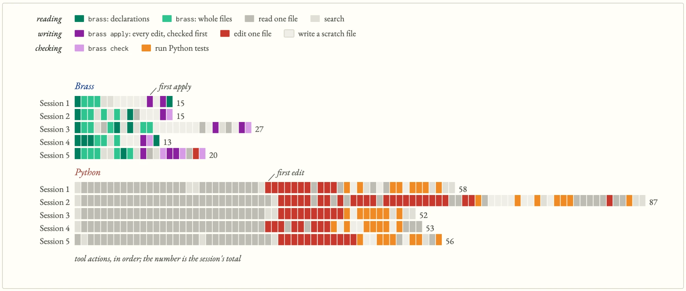
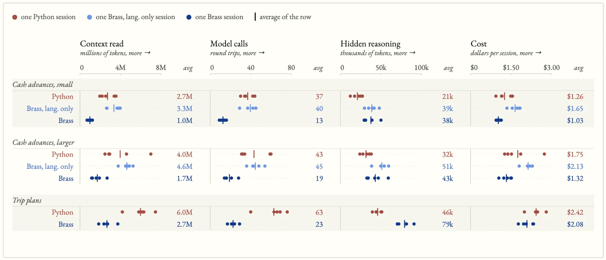

# Brass: an AI-first programming language

**A token-efficient programming language designed for AI to write and humans to trust.**

[Welcome to Brass Language](https://brass-lang.github.io/brass/welcome-to-brass-language.html) • [The AI Token Efficiency of Brass](https://brass-lang.github.io/brass/ai-token-efficiency-of-brass.html) • [Grammar](docs/brass-core-grammar.md) • [Request for comments](#request-for-comments)

Today, AI models write code in languages that were never designed for them. C++, Python and Rust were built for people doing that now-ancient thing of writing code by hand, so they reward clever abstractions and hidden dependencies. That's great when you already know the codebase. For a model, it means navigating five parent classes to understand one method.

Enter Brass, a language designed to help AI models spend fewer tokens understanding and changing code. The language itself favors explicitness over abstraction and is designed with built-in tooling, allowing AI models to navigate code and gather context more efficiently. Brass the language (and its tooling) is built around three ideas:

1. **Keep meaning local.** Each record lists its own fields. A function’s declaration shows its inputs, promises and access to outside services, so a model or reviewer can find those facts without tracing them through other implementations.

2. **Keep requirements in place when code changes.** A function’s contracts sit beside its declaration, separate from its implementation. A model can rewrite the body, but the full checker must prove that it still meets those contracts or reject the program.

3. **Help models find and change code.** The `brass` command shows declarations, finds their uses and checks patches before writing them. Those answers help a model decide what else it needs to read and which code to change.

Brass v0.3 includes the language specification and a working tool for navigating, editing and checking code. The tool checks program structure and runs examples. Trials have measured this setup against Python; the results follow below.

A formal compiler and runtime are what's up next for Brass.

**Interested and looking for a place to start?** Go with **[Welcome to Brass Language](https://brass-lang.github.io/brass/welcome-to-brass-language.html)**, a tour of the language through a park of dinosaurs and the doors that keep them in.

## The AI model token performance of Brass

**In these trials, Brass used fewer model calls and cost less than Python.**

The chart below follows ten attempts to add cash advances to the same expense-report system: five in Brass and five in Python. Each row shows one session, from its first read to its last check.

Brass used **13 to 27 tool actions** per session; Python used **52 to 87**. A single model call can request several actions, so this chart counts the individual reads, edits and checks.



Those ten sessions are part of a **40-session comparison**. Claude Sonnet added cash advances on two codebase sizes and trip plans as a third scenario.

Each scenario had five Python sessions and five Brass sessions. Another ten tested Brass with ordinary file tools only. In the results below, **Brass means the language and its tooling together.**

Across the three scenarios:

- **Fewer calls.** Brass averaged fewer than half as many requests to the model as Python.

- **Less text sent.** Average total input was less than half Python's. This includes conversation text sent again on later requests.

- **Lower bills.** Average costs were 14 to 24 percent lower, depending on the scenario.

- **Correctness.** Every hidden test passed in 13 of the 15 Brass sessions and all 15 Python sessions.

- **More reasoning.** The model spent 1.4 to 1.8 times as many reasoning tokens in Brass. Unfamiliarity may explain some of that difference, but these runs did not establish the cause.

The next chart shows every session, so you can see the spread behind the averages. Each dot is a session; the bar marks its row's average. The “lang. only” rows show Brass using ordinary file tools, without the `brass` command.



In an earlier test, giving Python a similar tool and a project map closed most of the difference in total text sent to the model.

The [full write-up](https://brass-lang.github.io/brass/ai-token-efficiency-of-brass.html) explains the comparisons. The [40-session snapshot](tools-and-testing/snapshot-20261019/) and [earlier tests](tools-and-testing/earlier-tests/) contain the inputs, finished programs and results.

## A quick Brass example

Here is an example Brass app, a small code file that adds two values and returns the result. The file also makes use of a few unique Brass conventions which are called out below:

```brass
# Code comment: an example add.brass file for adding two values
module math.add

interface
  # No access parameter: add cannot use outside services.
  fn add(a: Int, b: Int) -> Int
    before a > 0 and b > 0          # callers must provide positive values
    after result == a + b           # the result must equal their sum
    example add(2, 3) == 5          # one test, run on every check

body
  fn add(a, b) = a + b
```

As you can see, the `interface` states the function's requirements and the `body` implements them. If a model changes the body to cap the result at 100, `add(2, 3)` still passes its example, but larger inputs break the `after` promise. The full checker must reject that edit.

A few more simple code examples can be found in [Brass — everyday code](docs/brass-everyday-code.md).

## Exploring Brass
If you want to dive deep, I suggest reviewing documents in the following order:

- [Welcome to Brass Language](https://brass-lang.github.io/brass/welcome-to-brass-language.html): a tour through a dinosaur park's records, permissions and doors.
- [The AI Token Efficiency of Brass](https://brass-lang.github.io/brass/ai-token-efficiency-of-brass.html): what the trials measured.
- [Cheat sheet](docs/brass-cheat-sheet.md): every common form on one "page", with notes for Python and Rust programmers.
- [Specification](docs/brass-core-spec.md) for what's legal, [grammar](docs/brass-core-grammar.md) for what it looks like, and [principles](docs/brass-core-principles.md) for why.

Also check out [examples/](examples/) for a more robust demonstration of Brass and [History](HISTORY.md) if you are interested in understanding how Brass came to be.

## FAQ

**Why create another language instead of improving Python's tooling?**\
Applying the tooling in Brass to Python could help, and early testing showed this (to be explored more in the coming months). But specific to Brass, the language puts permissions and contracts into the language itself and leaves out features that make relationships harder to trace. Designing the language ***and*** tooling together lets those choices shape how code is written, inspected and checked.

**So is Brass a language or tooling to help an AI model?**\
Both, designed together. The language puts a function's inputs, promises and permissions in its declaration, so the facts a model needs are in one place. The `brass` tool reads those declarations back: it shows them, finds their uses and checks a patch before writing it. In the results, “Brass” means the two together. The language was also tested with ordinary file tools only, and that setup cost more than Python. See [The AI Token Efficiency of Brass](https://brass-lang.github.io/brass/ai-token-efficiency-of-brass.html).

**Does Brass have a target use case?**\
Brass was designed to target software whose permissions and business rules need to stay clear as it changes: payments, authorization, workflows, tools used by AI agents and provisioning. User interfaces, heavy numerical work and hard real-time systems are outside the current design philosophy.

**How can a model use Brass without a large body of existing code to learn from?**\
The trial sessions worked from a language reference and existing Brass programs, without training specifically for Brass. They completed the tasks, though they generally used more reasoning tokens than Python. Familiar syntax, explicit rules and tool feedback are intended to make that learning manageable.

**Does token efficiency mean writing shorter code?**\
No. Brass favors explicit declarations, even when they add lines. The aim is to reduce the work a model does to understand and change a program while keeping the code clear enough for a person to review.

**What comes next?**\
The full contract checker, followed by a compiled runtime. The next trials can then measure the work needed to reach a running result that meets the task's requirements, including failed attempts and repairs.

## Request for comments

What would you need to see before trusting a model's edit? What would you want to build that Brass cannot express? [Open an issue](https://github.com/brass-lang/brass/issues) with your question or example, or write to pcnofelt@[your standard google email provider].com.

---

The Brass specification and documentation are licensed under [CC BY 4.0](https://creativecommons.org/licenses/by/4.0/), and the code under the [Apache License 2.0](LICENSE). See [LICENSE-docs](LICENSE-docs) for details. © 2026 Peter Nofelt. Brass is a trademark of Peter Nofelt.
